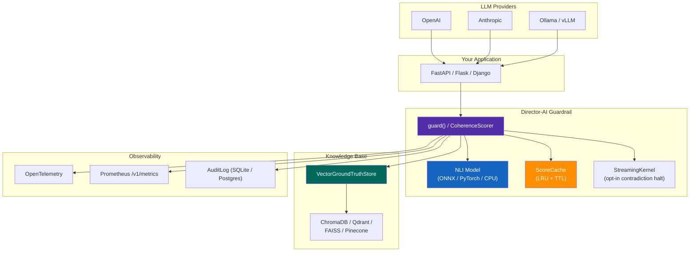

<!--
SPDX-License-Identifier: CC-BY-4.0
Commercial license available
© Concepts 1996–2026 Miroslav Šotek. All rights reserved.
© Code 2020–2026 Miroslav Šotek. All rights reserved.
ORCID: 0009-0009-3560-0851
Contact: www.anulum.li | protoscience@anulum.li
Director-AI — Production Deployment Guide
-->

# Production Deployment Guide

## Production support

<!-- production-support:start -->
<!-- Generated by tools/support_contract_check.py --write; do not edit. -->

production-qualified means qualified and maintained for production use on the named installation. It is not a service-level, warranty or support-contract commitment, and it grants no licence entitlement.

| Production-qualified operation | Installation | Activation | Scope |
|---|---|---|---|
| Rule-based prompt-injection screen | core | default | Blocks the declared override patterns and allows the probed benign input; its detection rate on injection attacks is not measured or qualified; consults no model. |
| Fact storage and word-overlap retrieval | core | default | Stores facts verbatim and retrieves them by word overlap; retrieval relevance is not qualified. |
| In-memory vector store plumbing | core | default | Storage and lookup only; embedding and ranking quality are not qualified. |
| Production guard refuses to run without model-backed NLI | core | default | The guard's verdicts are experimental under production-guard. |
| Compliance report and governance summaries | core+pro | command | anchor, drift, status and verify-anchors are experimental. |
| Compliance evidence kit | core+pro | command | Qualifies the kit's packaging and integrity; the scores and verdicts it packages are not qualified. |
| Evidence packet emission | core+pro | command | Qualifies the sealed packet and its integrity; its demonstration verdicts use the fast heuristic profile and are not qualified. |
| Evidence packet verification | core | command | Refuses a packet with one changed byte or a missing member. |
| REST server transport with the production security posture | core+pro + `server` | command | The verdict route /v1/review is experimental under model-scoring. |
| OpenAI-compatible proxy transport | core+pro + `server` | command | The proxy's scored completions are experimental under model-scoring. It exposes no metrics route and applies no rate limit. |
| PII redaction | core | default | Redacts the declared patterns of 8 classes (e-mail addresses, card numbers, US social security numbers, phone numbers, MRN, DOB and NHS identifiers, IBANs, passport numbers, IPv4 addresses); its recall on real data is not measured or qualified; consults no model. The production profile turns it on. Where the compliance trail is installed (core+pro, core+full), its strict construction refuses to start without a durable HMAC secret. |

Every other export, command, subcommand and route is experimental: source-available for evaluation, and its API may change. The production profile also turns on these experimental components: Batched review queue; Hybrid keyword and vector retrieval; Model-backed coherence scoring and the five-tier stack; Model-backed injection detection; Signed knowledge-base writes; Strict audit trail; Structured logs and OpenTelemetry; Tenant routing.

The full table: [production support contract](production-support.md).
<!-- production-support:end -->

## Architecture



## Recommended Setup

First follow the [local production walkthrough](../api/evidence-packet.md) to
check the installed package, scaffold and model-backed scoring on the bundled
policy facts.

For a production scaffold with authenticated service defaults, tenant routing,
audit stores, signed knowledge writes, and Prometheus-ready metrics:

```bash
director-ai quickstart --profile production
cd director_guard
```

Fill `.env` with the deployment API-key-to-tenant map, proxy API keys, LLM
and proxy upstream URLs, knowledge-write and audit HMAC keys, and CORS
origins. Then start the services:

```bash
docker compose up
```

For the bundled Prometheus profile, write the same API key to
`secrets/director-api-key` and start:

```bash
docker compose --profile monitoring up
```

Before promotion, generate the local conformal-routing, trajectory rollback,
multimodal temporal, federated privacy, auto-redteam defence, formal symbolic,
and sustained-load hardening packets and attach them to the release evidence:

```bash
PYTHONPATH=src python -m benchmarks.conformal_routing_evidence
PYTHONPATH=src python -m benchmarks.trajectory_rollback_evidence
PYTHONPATH=src python -m benchmarks.multimodal_temporal_evidence
PYTHONPATH=src python -m benchmarks.federated_privacy_evidence
PYTHONPATH=src python -m benchmarks.auto_redteam_defence_evidence
PYTHONPATH=src python -m benchmarks.formal_symbolic_evidence
PYTHONPATH=src python -m benchmarks.sustained_load_evidence
```

Customer Model Factory promotion also requires the formal-symbolic packet URI,
external Lean proof URI, actual Z3 release packet URI, domain contracts URI,
code-contract packet URI, verification flags, operator sign-off, and evidence
hash in the release gate.

```bash
pip install director-ai[nli,vector,embeddings,openai]
```

```python
from director_ai import guard, CoherenceScorer, VectorGroundTruthStore, ChromaBackend

# Production vector store with persistent storage
backend = ChromaBackend(
    collection_name="prod_facts",
    persist_directory="/data/chroma",
    embedding_model="BAAI/bge-large-en-v1.5",
)
store = VectorGroundTruthStore(backend=backend)

# Ingest your knowledge base
store.ingest(your_documents)

# Create scorer with caching and NLI
scorer = CoherenceScorer(
    threshold=0.6,
    soft_limit=0.7,
    use_nli=True,
    nli_model="lytang/MiniCheck-DeBERTa-L",
    ground_truth_store=store,
    cache_size=2048,
    cache_ttl=600,
    nli_quantize_8bit=True,
    nli_device="cuda",
)

# Optional: enable injection detection on every review()
scorer.enable_injection_detection(
    injection_threshold=0.7,
    baseline_divergence=0.4,
)
```

The production profile requires model-backed NLI. With
`scorer_backend: auto`, startup selects a configured ONNX model or uses
DeBERTa. Startup checks that the selected model can load before serving.
The standalone Rust scorer provides heuristic scoring for profiles
that allow it. Explicit backend choices still pass through the same
model requirement check.

## Calibrate on deployment traffic

Use reviewed requests from the target model, domain and retrieval path.
Record the starting score policy and fit a candidate on representative
labelled data. The [operating-points command](../guide/online-calibration.md#task-routed-operating-points)
writes a candidate overlay for the dialogue and summarization support routes.
Use [reviewed feedback](../guide/online-calibration.md#calibrating) to measure
false approvals and false rejections and propose a coherence threshold.
Before applying either change, check errors, abstentions and sample counts
on separate labelled data. Recheck those metrics when the environment or
traffic changes.

## Scaling

### Horizontal: Multiple Workers

```bash
uvicorn director_ai.server:app --workers 4 --host 0.0.0.0 --port 8080
```

Each worker gets its own scorer instance. The NLI model is loaded once per worker via `lru_cache`.

!!! warning "Rate limiting across workers and instances"
    Rate limiting is **in-memory and per worker process** unless a shared backend
    is configured. With `--workers N` (or several instances behind a load
    balancer) and no shared store, the effective limit is multiplied by the
    number of processes. Set `redis_url` so the server's SlowAPI limiter uses
    Redis for a single global limit; the server logs a warning at startup when
    `server_workers > 1` and no `redis_url` is set. The standalone
    `RateLimitMiddleware` also accepts `redis_url` or an injected shared store;
    use one of those, the main server's Redis-backed limiter, or a reverse
    proxy/API gateway for multi-instance enforcement.

!!! note "Request-size and NLI-cost limits"
    The REST server rejects oversized text before sanitizer, redaction, batch
    workers, or NLI scoring. Single `/v1/process` prompts are capped at 100,000
    characters, single review responses at 500,000 characters, `/v1/batch`
    prompt text at 1,000,000 aggregate characters, and `/v1/batch` response
    text at 2,000,000 aggregate characters.

### GPU Sharing

For multi-worker GPU sharing, load the model once and share via torch multiprocessing:

```python
scorer = CoherenceScorer(
    use_nli=True,
    nli_device="cuda:0",
    nli_torch_dtype="float16",
    nli_quantize_8bit=True,
)
```

8-bit quantization reduces VRAM from ~1.5GB to ~400MB per model.

### Edge And Mobile Release Evidence

Browser, Worker, mobile, and embedded deployments use the WASM halt kernel plus
a host-owned scorer. Before release, generate:

```bash
PYTHONPATH=src python -m benchmarks.edge_mobile_evidence
```

The packet must show `ready_for_release=true` for customer release. If it only
shows `ready_for_local_trial=true`, the source contracts and docs are present
but release evidence is still missing for local WASM artefacts, quantised model
artefacts, browser/Web Worker smoke, and mobile or embedded-device smoke.

### Score Caching

Enable caching to reduce NLI inference by 60-80% in streaming workloads:

```python
scorer = CoherenceScorer(
    cache_size=4096,
    cache_ttl=300,
)

# Monitor cache performance
print(f"Hit rate: {scorer.cache.hit_rate:.1%}")
```

## Resource Sizing

| Workload | CPU | RAM | GPU | Latency (measured) |
|----------|-----|-----|-----|--------------------|
| Heuristic only | 1 core | 256MB | None | <0.1 ms |
| **ONNX GPU batch** | 2 cores | 2GB | 1.2GB VRAM | **14.6 ms/pair** |
| PyTorch GPU batch | 2 cores | 2GB | 1.2GB VRAM | 19 ms/pair |
| ONNX GPU sequential | 2 cores | 2GB | 1.2GB VRAM | 65 ms/pair |
| PyTorch GPU sequential | 2 cores | 2GB | 1.2GB VRAM | 197 ms/pair |
| ONNX CPU batch | 4 cores | 2GB | None | 383 ms/pair |
| MiniCheck (GPU) | 2 cores | 1GB | 400MB VRAM | ~60 ms |
| + bge-large embeddings | +1 core | +500MB | +200MB VRAM | +5 ms |

## Monitoring

### Prometheus Metrics

```python
from director_ai.core.metrics import metrics

# Built-in metrics exposed at /v1/metrics and /v1/metrics/prometheus
print(metrics.prometheus_format())
```

When API keys are configured, `/v1/metrics/prometheus` requires authentication
by default. Prometheus-compatible scrapers can use:

```http
Authorization: Bearer <api-key>
```

Available metrics:

| Metric | Type | Description |
|--------|------|-------------|
| `director_ai_reviews_total` | counter | Total review requests |
| `director_ai_reviews_approved` | counter | Approved reviews |
| `director_ai_reviews_rejected` | counter | Rejected reviews |
| `director_ai_halts_total` | counter | Safety kernel halts (by reason) |
| `director_ai_coherence_score` | histogram | Score distribution |
| `director_ai_review_duration_seconds` | histogram | Review latency |
| `director_ai_active_requests` | gauge | In-flight requests |

### Health Check

```python
@app.get("/health")
def health():
    return {
        "status": "ok",
        "nli_loaded": scorer._nli and scorer._nli.model_available,
        "cache_hit_rate": scorer.cache.hit_rate if scorer.cache else None,
        "cache_size": scorer.cache.size if scorer.cache else 0,
    }
```

## Continuous Batching (ReviewQueue)

For API servers under concurrent load, enable server-level request accumulation.
The queue collects incoming `/v1/review` requests and flushes them as a single
`review_batch()` call. Eligible pairs share NLI passes. Claim verification,
reasoning, and output detection complete a review for each pair.

```python
from director_ai.core.config import DirectorConfig
from director_ai.server import create_app

config = DirectorConfig(
    review_queue_enabled=True,
    review_queue_max_batch=32,
    review_queue_flush_timeout_ms=10.0,
)
app = create_app(config)
```

Environment variable override:

```bash
DIRECTOR_REVIEW_QUEUE_ENABLED=1 \
DIRECTOR_REVIEW_QUEUE_MAX_BATCH=64 \
DIRECTOR_REVIEW_QUEUE_FLUSH_TIMEOUT_MS=20 \
uvicorn director_ai.server:app --host 0.0.0.0 --port 8080
```

Session-bound requests (with `session_id`) bypass the queue automatically.
Tenant groups inside one flush are dispatched concurrently. This preserves
tenant-specific scorer calls while avoiding a response-time signal that scales
linearly with the number of tenants represented in the flush window.

### Latency SLO qualification

Do not turn a development-machine benchmark into a universal latency claim.
Hardware, model backend, queue settings, network path, concurrency, and other
host load all affect end-to-end latency. Qualify the exact deployable operating
point instead:

```bash
# DIRECTOR_API_KEY may be set for an authenticated production deployment.
director-ai latency-slo \
  --server http://127.0.0.1:8080 \
  --requests 500 \
  --warmup 50 \
  --concurrency 16 \
  --target-p95-ms 500 \
  --max-error-rate 0.01 \
  --output evidence/latency-slo.json
```

The command checks `/v1/ready`, sends a benign default workload through the real
`/v1/review` HTTP boundary, excludes warmup requests, and exits with status 2
when either the p95 or error-rate target is missed. Successful reviews require
a boolean `approved` verdict and a finite numeric `coherence` score from 0 to 1.
Its integrity packet records
the operating point, aggregate p50/p95/p99, throughput, runtime provenance,
workload hash, and failure categories. It never records the API key or raw
prompt/response bodies.

Use `--workload path/to/reviews.jsonl` for an ordered production-like set of
UTF-8 JSON rows with nonblank `prompt` and `response` strings. Warmup uses the
first pairs and measurement continues at the next pair. Both phases wrap at
the end of the file. Record the request mix and cache conditions with the
result. The packet binds the ordered pairs by SHA-256.

An exit status of 0 supports only this statement: **this deployment met the
declared target for this workload and operating point**. It does not establish
a hard real-time or hardware-independent guarantee. Re-run after changing the
image, model, host, queue settings, reverse proxy, or concurrency target, and
retain the evidence packet with the release evidence.

ReviewQueue reduces model invocations per flush window when the selected backend
supports batch scoring. Its flush timeout also adds queueing time. The correct
latency number is therefore the value measured for the deployed configuration,
not a generic number attached to ReviewQueue.

## Security

- Store API keys in environment variables, not config files
- Use `DirectorConfig._REDACTED_FIELDS` for safe serialization
- Enable `InputSanitizer` to filter prompt injection attempts
- Audit all rejections via `AuditLogger`

### Experimental Hooks

Keep experimental hook packages disabled for live deployments unless they run
behind a separately isolated service boundary with operator review. This
includes `meta_guard`, `self_evolving`, `continual_adversarial`, and adjacent
research surfaces that can adapt prompts, policies, adversarial examples, or
runtime decisions.

For production use, route these hooks through a non-serving evaluation lane
first. Promote a hook only after replay tests, tenant-safe audit logging,
rollback instructions, and human review are in place for the deployment.

The nightly live red-team workflow runs both current jailbreak/evasion data and
property contract gates for experimental namespace loading, cross-language
serialisation, zk attestation, and cyber-physical halt contracts. Keep those
property gates green before promoting experimental hooks or changing generated
protocol boundaries.

## Production Checklist

Before going live, verify each item:

- [ ] **NLI model enabled** — set `use_nli=True` (heuristic-only misses subtle contradictions)
- [ ] **Persistent vector store** — configure ChromaDB or Qdrant (`vector_backend="chroma"`, `chroma_persist_dir="/data/chroma"`)
- [ ] **Score caching** — set `cache_size` and `cache_ttl` to reduce NLI inference load
- [ ] **Audit logging** — set `audit_log_path="audit.jsonl"` to enable `AuditLogger`
- [ ] **Prometheus scraping** — configure your monitoring to scrape `/v1/metrics/prometheus`
- [ ] **CORS origins** — set `cors_origins` to exact browser origins and mirror them in the reverse proxy
- [ ] **Rate limiting** — set `rate_limit_rpm=60` (or appropriate limit) to prevent abuse
- [ ] **Caller credentials** — configure the server credential list and require `X-API-Key`
- [ ] **Correlation IDs** — `X-Request-ID` headers are automatic; log them for tracing
- [ ] **Tenant isolation** — set `tenant_routing=True` if serving multiple customers
- [ ] **Regression test** — run `python -m benchmarks.regression_suite` and confirm all assertions pass
- [ ] **Streaming oversight** — if using WebSocket `/v1/stream`, enable `streaming_oversight` for real-time halt
