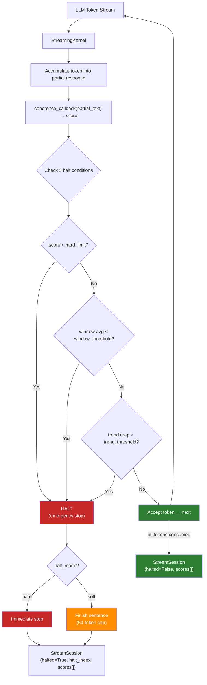

<!--
SPDX-License-Identifier: Apache-2.0
Commercial license available
© Concepts 1996–2026 Miroslav Šotek. All rights reserved.
© Code 2020–2026 Miroslav Šotek. All rights reserved.
ORCID: 0009-0009-3560-0851
Contact: www.anulum.li | protoscience@anulum.li
Director-AI — Streaming halt guide
-->

# Streaming Halt

!!! note "Opt-in contradiction halt"
    With contradiction halt enabled, Director-AI scores completed claims for
    `P(contradiction)` against retrieved grounding facts. The stream stops
    when that probability reaches the configured threshold.

    Response-level scoring remains the production gate. See
    [benchmark evidence and failure modes](#measured-behaviour) for what
    this interlock measures and what a client can receive before a halt.

## Overview

`StreamingKernel` monitors a caller-supplied score by re-scoring the accumulated
text after each token (or every N-th token with `score_every_n`). The production
streaming signal is the contradiction-driven claim gate below; the generic
kernel still provides three halt mechanisms:

1. **Hard limit** — any single token below threshold
2. **Sliding window** — rolling average drops below window threshold
3. **Downward trend** — coherence drops by more than a delta over N tokens

## Architecture



The caller supplies the `coherence_callback` — typically a closure that accumulates tokens, calls `scorer.review()`, and returns the score. The kernel only decides *when to halt*; the caller decides *how to score*.

## How NLI Premise/Hypothesis Are Constructed

When `use_nli=True` on the scorer:

1. **Premise** = the prompt text, or the top-k retrieval results from `GroundTruthStore` / `VectorGroundTruthStore` if a KB is configured.
2. **Hypothesis** = the accumulated response text so far (all tokens joined).
3. The NLI model (DeBERTa) scores the entailment probability P(premise entails hypothesis).
4. The divergence score is `1.0 - entailment_probability` — higher means more hallucination risk.

With chunked NLI (`NLIScorer.score_chunked()`):

- Both premise and hypothesis are split into sentence-level chunks.
- All (premise_chunk, hypothesis_chunk) pairs are scored.
- The final score uses **max aggregation** across pairs — the worst contradiction in any pair drives the score.
- This catches localized hallucinations that would be diluted in a full-text comparison.

## Basic Usage

```python
from director_ai import StreamingKernel

kernel = StreamingKernel(
    hard_limit=0.4,
    window_size=10,
    window_threshold=0.55,
    trend_window=5,
    trend_threshold=0.15,
    soft_limit=0.6,
)

session = kernel.stream_tokens(token_generator, coherence_callback)

if session.halted:
    print(f"Halted: {session.halt_reason}")
    print(f"Safe output: {session.output}")
else:
    print(f"Approved: {session.output}")
```

## on_halt Callback

```python
def handle_halt(session):
    print(f"Halted at token {session.halt_index}")
    # Log, alert, switch to fallback


kernel = StreamingKernel(on_halt=handle_halt)
```

The synchronous output monitor exposes `HaltMonitor.stream_output_result()`
for callers that need the verdict alongside the output text. It reports a
reason when delivery stops and a last score when it has successfully checked
one. The existing `stream_output()` method continues to return the text.

## Async Streaming

```python
from director_ai import AsyncStreamingKernel

kernel = AsyncStreamingKernel(
    hard_limit=0.4,
    on_halt=handle_halt,
    soft_limit=0.6,
)

session = await kernel.stream_to_session(async_token_gen, coherence_fn)
```

The async kernel awaits scores returned as coroutines, tasks or futures before
deciding whether to deliver a token. Callbacks can also return a score directly.

Both Python kernels leave the gate inactive after an actual halt; call
`reactivate()` before starting another stream. With `halt_mode="soft"`, a window
or trend violation permits tokens until the next sentence boundary or 50
additional tokens. A hard-limit violation still stops immediately, including
while a soft halt is pending. Soft halts deliberately allow more output and
cannot guarantee that the additional text is grounded.

The collected async session preserves the initial soft-halt reason and trigger
index in `halt_reason` and `halt_index`. Its `soft_halted` flag is true and its
`output` includes the delivered sentence; a hard halt excludes the violating
token. The session callback runs once after collection, and each collected
session retains its own halt metadata. These generic Python soft-halt controls
are separate from the contradiction-driven claim gate and are not a native
WASM soft-halt feature.

Async session stop causes distinguish `token_timeout`, `total_timeout`,
`callback_error` and `kernel_inactive` from the score-based halt reasons.
Operational failures may use a fallback event score; that value is not a
measured contradiction score. Timeouts are checked after a source or callback
returns and do not forcibly cancel a stalled producer or synchronous callback.

For the coherence-based `CoherenceAgent.stream()` path, each call keeps its
own score window and trend history. Concurrent calls on the same agent use
the configured thresholds with independent histories.

The base installation supports whole-response scoring through the Python
heuristic when NLI is disabled and the automatic scorer selects its fallback.
Generic token-level coherence oversight uses `director-ai[rust]` for the
rolling-window and trend checks. If the runtime reaches one of those checks
without the extension, the SDK raises an installation error and SSE emits a
terminal `error` event. The opt-in contradiction path with a streaming
provider uses its NLI model and grounding store for claim decisions.

## REST SSE Endpoint

SSE and WebSocket oversight deliver a terminal `halt` event with the reason,
trigger score and delivered-token count. The transport withholds the triggering
token when the agent flags a halt. For a whole-response provider, the reason
comes from the response verdict, including `hard_limit` and `kernel_inactive`
when the final output monitor refuses delivery.
With contradiction halt enabled, the configured contradiction threshold decides
these events. Coherence-based streaming also applies the server's configured
egress limits.

The local generation adapter treats `[DONE]` as the end of the response and
uses whole completion JSON when the upstream returns it. It can request a
whole completion as a fallback before any output starts. If the upstream
fails after output starts, the stream reports the failure with the original
prefix intact. Whole-completion requests run off the event loop.
Scoring preserves the provider's text across chunk boundaries. A number or
word split across events is reassembled without inserting whitespace. A whole
JSON completion retains its original spacing for scoring and emits the usual
word tokens to clients.

`POST /v1/stream/sse` serves the same two session shapes as the
`/v1/stream` WebSocket — whole-answer processing and token-level
pre-egress oversight — as a `text/event-stream` response, for
server-to-server callers, `curl`, and clients behind proxies that
block WebSockets. Auth and tenant binding use the standard REST
middleware, so no ticket exchange is needed:

```bash
curl -N -X POST http://localhost:8000/v1/stream/sse \
  -H "X-API-Key: $KEY" -H "Content-Type: application/json" \
  -d '{"prompt": "Explain RRF fusion.", "streaming_oversight": true}'
```

Event names mirror the WebSocket message types: `token` frames carry
`{token, coherence}`, the terminal frame is `halt` or `complete`
(oversight) or a single `result` (whole-answer), and mid-stream
failures arrive as an `error` event. Validation problems are rejected
before the stream starts as plain HTTP errors (400/413/503). The
halting token is never delivered — identical pre-egress semantics to
the WebSocket branch.

## Pre-Sampling Inference Server Hooks

`InferenceServerHook` is the adapter boundary for vLLM, TGI, and
llama.cpp deployments that want a decision before a candidate token is
accepted. The hook is stdlib-only; server packages call `check()` from
their own logits or token-filter callback and then apply the returned
payload.

```python
from director_ai import InferenceHookRequest, build_inference_server_hook


def coherence_fn(text: str) -> float:
    return scorer.review(prompt, text).score


hook = build_inference_server_hook(
    "vllm",
    coherence_fn,
    hard_limit=0.4,
)

decision = hook.check(
    InferenceHookRequest(
        server="vllm",
        accumulated_text="The measured value is ",
        candidate_token="grounded",
        token_id=42,
        request_id="req-123",
    ),
    logits=[0.0] * 100,
)

if not decision.allow:
    emit(decision.safety_event.to_dict())
    apply_server_payload(decision.server_payload)
```

On a halt, the hook returns masked logits when logits are supplied, the
server-specific action payload, blocked token ids when known, and a
tenant-safe `SafetyEvent` with `hook_scope="inference_server"`.

Predictive pre-halt decisions can be applied through the same server boundary.
Pass a `PreHaltSteeringDecision` from the trajectory preflight controller to
`steer()`. `proceed` preserves logits, `escalate` applies a finite negative
logit bias to the candidate token while allowing sampling to continue, and
`halt` uses the same hard block path as `check()`.

```python
steering_decision = prehalt.evaluate(
    verdict,
    risk_envelope=risk_envelope,
    policy_id="policy.prehalt.regulated",
)

decision = hook.steer(
    InferenceHookRequest(
        server="vllm",
        accumulated_text="The measured value is ",
        candidate_token="candidate",
        token_id=42,
        request_id="req-123",
    ),
    steering_decision,
    logits=[0.0] * 100,
)

apply_server_payload(decision.server_payload)
```

The pre-halt safety event carries calibrated risk, confidence bounds, policy
identity, server name, and token id when known. It does not carry prompt text or
candidate text.

## Threshold Tuning by Domain

| Domain | hard_limit | window_threshold | trend_threshold | window_size | Rationale |
|--------|-----------|-----------------|----------------|-------------|-----------|
| General | 0.4 | 0.50 | 0.15 | 10 | Balanced — catches obvious hallucinations without over-halting |
| Medical | 0.5 | 0.60 | 0.10 | 8 | Strict — medical misinformation is high-risk |
| Finance | 0.5 | 0.55 | 0.12 | 8 | Strict — numerical claims must be grounded |
| Legal | 0.45 | 0.55 | 0.12 | 10 | Moderate-strict — citations and precedent matter |
| Creative | 0.3 | 0.40 | 0.20 | 15 | Loose — creative writing tolerates divergence |

See the [Threshold Tuning Guide](threshold-tuning.md) for detailed tuning methodology.

## Debug Mode

Enable `streaming_debug=True` to get per-token diagnostic snapshots:

```python
kernel = StreamingKernel(
    hard_limit=0.4,
    window_size=10,
    streaming_debug=True,
)

session = kernel.stream_tokens(token_gen, coherence_cb)

for snap in session.debug_log:
    print(
        f"token {snap['index']}: "
        f"coherence={snap['coherence']:.3f} "
        f"window_avg={snap['window_avg']:.3f} "
        f"trend_drop={snap['trend_drop']:.3f} "
        f"accumulated={snap['accumulated_tokens']}"
    )
```

Each `TokenEvent` also gets a `debug_info` dict with the same fields. Use this to diagnose why a halt triggered or to tune thresholds on your data.

**Fields in each debug snapshot:**

| Field | Type | Description |
|-------|------|-------------|
| `index` | int | Token position in stream |
| `coherence` | float | Raw coherence score for this token |
| `window_avg` | float | Current sliding window average |
| `trend_drop` | float | Coherence delta over trend window |
| `accumulated_tokens` | int | Total tokens processed so far |

## False-Halt Rate

Measured with `benchmarks/streaming_false_halt_bench.py` on 135 factually correct passages (heuristic mode, `use_nli=False`):

| Metric | Value |
|--------|-------|
| Passages tested | 135 |
| False halts | 6 |
| False-halt rate | **4.4%** |
| Avg coherence | 0.459 |
| Synthetic bad-passage halt precision | 14.3% |
| Synthetic bad-passage halt recall | 33.3% |
| Token-of-halt accuracy, 8-token window | 0.0% |

All 6 false halts are trend-triggered on borderline score trajectories
(trend drop barely exceeding 0.30 threshold). NLI mode produces higher
coherence scores and is expected to have a lower false-halt rate.
The heuristic benchmark now reports halt precision, halt recall, and
token-of-halt accuracy on a small labelled bad-passage smoke set. Treat those
rows as halt-quality diagnostics, not as a hallucination benchmark or a
customer-domain guarantee.

The regression suite (`benchmarks/regression_suite.py`) asserts
`false_halt_rate < 5%` on every CI run.

To reproduce:

```bash
python -m benchmarks.streaming_false_halt_bench
```

With NLI enabled (requires `pip install director-ai[nli]`):

```bash
python -m benchmarks.streaming_false_halt_bench --nli
```

## Structured Halt Evidence

When a `scorer` is passed to `stream_tokens()`, halt events include a
`HaltEvidence` object with up to `top_k` retrieved chunks and any available
NLI scores.

`top_k` limits the retrieved facts attached to the packet. NLI scores
describe the hypothesis chunks in generation order. A halt evidence review
reads the current tenant's grounding directly, even when the scalar score
cache has an entry for the same prefix.

```python
session = kernel.stream_tokens(
    token_generator,
    coherence_callback,
    scorer=scorer,
    top_k=3,
)

if session.halt_evidence_structured:
    ev = session.halt_evidence_structured
    print(f"Reason: {ev.reason}")
    print(f"Score: {ev.last_score:.3f}")
    print(f"Action: {ev.suggested_action}")
    if ev.trace_attribution:
        trace = ev.trace_attribution
        print(f"Token: {trace.token_offset}")
        print(f"Path: {trace.scorer_path}")
    if ev.counterfactual_diagnostic and ev.counterfactual_diagnostic.best_change:
        change = ev.counterfactual_diagnostic.best_change
        print(f"Fact source: {change.fact_source}")
        print(f"Required delta: {change.required_score_delta:.3f}")
    for chunk in ev.evidence_chunks:
        print(f"  - {chunk.text[:80]} (distance={chunk.distance:.3f})")
```

The terminal `TokenEvent` contains the same `HaltEvidence` object as the
session. Its attribution records the trigger token offset, threshold and
margin measured when the condition was met. For a deferred halt, the scorer
and evidence callback receive the prefix through the trigger token. The event
and delivered output still include the sentence ending. The counterfactual
diagnostic applies its score intervention model to the trigger observation.

For tenant-scoped halt evidence, pass the authenticated `tenant_id` to
`stream_tokens()`. The kernel forwards that identity to `scorer.review()`,
safety events and token traces. The native `rust` and `backfire` scorer paths
also bind this identity to their retrieval callback for that invocation; see
[Rust Python bindings](rust-ffi.md). A backend serving tenant-scoped requests must
apply that identity to its retrieval and score-cache lookups. Authentication
and authorisation belong to the calling application. Omitting the identifier
retains the scorer's unscoped behavior.

When OpenTelemetry is enabled, the same halt fields are exported as
`stream.halt_cause.*` and `stream.counterfactual.*` attributes on
streaming spans. Raw token text and raw fact text are not written to
spans.

## Trace Explorer

The `[ui]` extra includes a Trace Explorer tab in the Gradio wizard.
Paste JSON from a `StreamSession`, agent trace, swarm trace, or halt
evidence payload to render a timeline with scope, event type, halt
state, score, hook, reason, attribution, and counterfactual detail.

```python
import json

from director_ai.ui.config_wizard import build_trace_explorer

summary, rows, detail = build_trace_explorer(
    json.dumps(
        {
            "halted": True,
            "halt_reason": "hard_limit",
            "events": [
                {"index": 0, "token": "The", "coherence": 0.92},
                {
                    "index": 1,
                    "token": " claim",
                    "coherence": 0.31,
                    "halted": True,
                    "halt_reason": "hard_limit",
                },
            ],
        },
    ),
)
```

The pure helper returns Markdown summary text, table rows for the UI,
and a JSON detail object. This keeps trace rendering testable without
launching Gradio.

## StreamSession Properties

| Property | Type | Description |
|----------|------|-------------|
| `output` | str | Safe partial output (up to halt point) |
| `halted` | bool | Whether generation was stopped |
| `halt_index` | int | Token index where halt occurred |
| `halt_reason` | str | Which mechanism triggered |
| `avg_coherence` | float | Mean coherence across all tokens |
| `min_coherence` | float | Lowest coherence observed |
| `warning_count` | int | Tokens in soft warning zone |
| `duration_ms` | float | Total processing time |
| `debug_log` | list[dict] | Debug snapshots (only when `streaming_debug=True`) |

## Limitations

- **Accumulated-text scoring, not per-token**: Each coherence score
  reflects the full accumulated output re-evaluated against the premise.
  Individual tokens don't have independent scores.
- **No retraction**: Halting stops future tokens from being generated,
  but tokens already delivered to the client cannot be retracted.
  Applications that need full rollback should buffer output until a
  sentence boundary passes scoring.
- **Scoring granularity depends on the NLI backend**: Heuristic mode uses
  word overlap (~0.1 ms/call), NLI mode runs the full DeBERTa pipeline
  (~15-50 ms/call). Use `score_every_n > 1` or `adaptive=True` for
  production latency budgets.
- **Hosted API constraints**: When using OpenAI/Anthropic providers, the
  scorer re-runs the full NLI pipeline on the accumulated text. There is
  no server-side per-token scoring.

## Contradiction-driven halt

The coherence halt above folds *unsupported* into *divergence*
(`divergence = P(contradiction) + 0.5·P(neutral)`), so a correct-but-unmentioned
claim can score low and be halted. The contradiction-driven halt instead
fires only when a completed claim **contradicts** the retrieved grounding — a
correct-but-unsupported claim is neutral, not a contradiction, so it is allowed.

How it works:

- the agent accumulates provider chunks until a chunk ends with claim
  punctuation (`.`, `!`, `?`, `;`, or `:`). A trailing fragment keeps the
  previous score until the stream ends;
- the claim is scored for `P(contradiction)` from a three-class NLI model
  (`ContradictionScorer`) against each grounding fact retrieved for the
  request's tenant, and the strongest contradiction decides;
- when retrieval returns no usable facts, the gate records no contradiction
  and continues. Claims without support still need response-level review.

Enable it on the server via configuration. It is off by default because it needs
the `nli` extra and deployment-owned latency sizing:

```python
DirectorConfig(
    streaming_contradiction_halt=True,
    streaming_contradiction_threshold=0.2,  # P(contradiction) to halt
    streaming_contradiction_device=-1,  # CUDA index, -1 = CPU
)
```

### Measured behaviour

The [archived A30 run](https://github.com/anulum/director-ai/blob/a92103dc6c9f841bfbdc9a17b3d321fd3e75f7bc/benchmarks/results/streaming_contradiction_halt_base.json)
used an isolated NVIDIA A30, Python 3.11.15 and
`MoritzLaurer/DeBERTa-v3-large-mnli-fever-anli-ling-wanli`. It measured 4/612
false halts and caught 364/507 contradictions at threshold 0.5.

| Label in the benchmark | Outcome counted | Passages | Rate |
|---|---|---:|---:|
| Grounded | 4 false halts | 612 | 0.0065 |
| Semantic contradiction | 15 misses | 217 | 0.0691 |
| Numeric contradiction | 128 misses | 290 | 0.4414 |
| All contradictions | 143 misses | 507 | 0.2821 |

The [original runner](https://github.com/anulum/director-ai/blob/a92103dc6c9f841bfbdc9a17b3d321fd3e75f7bc/benchmarks/streaming_contradiction_halt_bench.py)
passed the command's `--threshold 0.5` to the interlock and wrote the scorer's
default `0.2` into the report's top-level `threshold` field. A later shared-CPU
replay pinned model revision `b3546ea6b0346eb6f8d5d68b13c7dc6d0376b3d7` and
reproduced the counts at `0.5`. The replay establishes the recorded operating
point for this corpus. It supplies no latency result for production traffic,
and the current runtime configuration defaults to `0.2`.

The benchmark replays labelled passages with whitespace tokenization and a
three-word minimum per claim. Live SSE, WebSocket and gRPC sessions use
provider chunk boundaries and the agent's claim punctuation rule. A final
unpunctuated fragment can leave the previous score in place. The benchmark
estimates neither misses caused by unavailable or irrelevant grounding nor
false halts on claims whose support status is unknown.

A missing retrieval hit lets the claim proceed. Incorrect or stale retrieved
facts can cause an unnecessary halt or hide a real contradiction.
An exception raised by retrieval or scoring interrupts the agent stream.
The server protocols report handled runtime exceptions as stream errors.
Plan for the possibility that a client has already received a prefix before
the error or halt.

The OpenAI-compatible proxy has a separate disclosure policy over periodic
response reviews. In `immediate` mode it can release content before rejection.
With `--on-fail reject`, `--stream-disclosure buffered` holds the next window
until review and discards that unreleased window on rejection. The proxy
normally reviews every eight content chunks and at stream completion.
Previously reviewed and released windows remain with the client.

On synthesised, unambiguous contradictions
(`benchmarks/contradiction_recall.py`, 25,882 injected variants of supported
LLM-AggreFact claims) the off-the-shelf NLI model reaches **AUC 0.82** with
**recall 51.5 %** of true contradictions at a **6.7 % false-halt** rate on the
originals (threshold 0.2). The raw AggreFact *unsupported* class mixes
genuine contradictions with claims that lack support. Its halt fraction
(`benchmarks/contradiction_aggrefact.py`) therefore cannot estimate
contradiction recall. The archived passage-level variant recorded more
false halts without higher recall.

The off-the-shelf model caps near 51 % recall on clean injected contradictions;
a model fine-tuned on the contradiction-vs-unsupported boundary is the path to
higher recall. Reproduce with `python -m benchmarks.contradiction_recall` and
`python -m benchmarks.contradiction_aggrefact` (`--device 0` for GPU).

### Fine-tuned held-out result

A LoRA fine-tune of the same base (`MoritzLaurer/DeBERTa-v3-large-mnli-...`) on
the AggreFact-derived contradiction set — supported → entailment, injected →
contradiction, unsupported and cross-document → neutral — is evaluated
leakage-free on the held-out eval split (6,321 pairs; 2,589 contradiction, 1,449
neutral, 2,283 entailment) with the production halt rule `P(contradiction) ≥
threshold`. The split was held out at dataset-build time, so the base and the
fine-tuned model are compared on identical, unseen data:

| Threshold | Recall (base → fine-tuned) | False-halt (base → fine-tuned) |
|---|---|---|
| 0.1 | 0.548 → **0.981** | 0.083 → 0.146 |
| 0.2 | 0.521 → **0.974** | 0.065 → 0.099 |
| 0.3 | 0.504 → **0.967** | 0.056 → 0.080 |
| 0.5 | 0.477 → **0.958** | 0.046 → 0.059 |

AUC (contradiction vs. entailment+neutral) rises **0.82 → 0.99**. The fine-tune
roughly doubles contradiction recall at a modest false-halt increase, confirming
the fine-tuning path predicted above. The adapter is trained locally
(`python -m training.train_contradiction`); the held-out comparison is
`python -m training.eval_contradiction_holdout --tag base|finetuned`, with results
in `benchmarks/results/contradiction_holdout_{base,finetuned}.json`. Promoting the
fine-tuned weights to the shipped default requires publishing the merged model;
until then the off-the-shelf base remains the configured `ContradictionScorer`.
